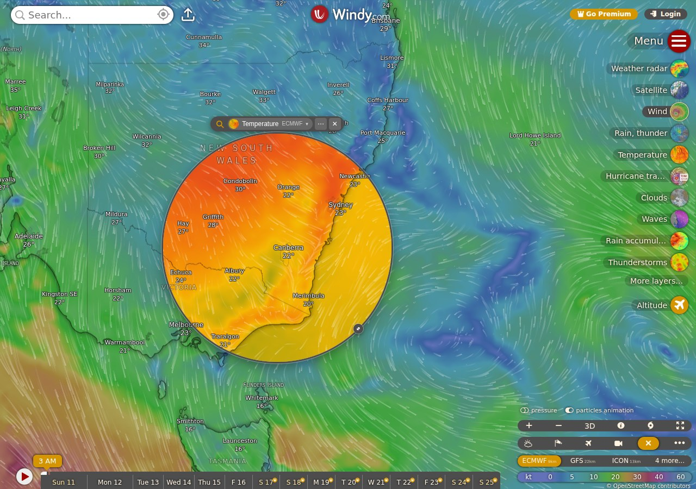

# Layer Lens

A [Windy](https://www.windy.com) plugin that shows a second weather layer through a movable lens.
The lens, round or rectangular, sits over the map and shows any other layer for the exact spot
it covers, with its own forecast model and altitude.



## Using it

-   **Drag** the lens by its bar (or, when round, by the lens mark on its pill). **Resize** it
    from any edge or corner, or with the knob on the rim of a round lens.
-   The **layer button** opens the picker: Windy's own layers with their thumbnails, grouped and
    searchable, plus the forecast models and altitudes available for the layer shown.
-   The **⋯ menu** switches between two views and two shapes:
    -   _Seamless_: the lens shows the part of the main map it covers.
    -   _Full_: the lens shows the whole view of the main map, zoomed out to fit.
-   Panning or zooming either map moves the other. The lens follows the main map's forecast time.

On phones and tablets the lens does not float. It is docked in the strip Windy gives small
plugins at the foot of the screen.

## How it works

The lens holds a second, complete Windy in a same-origin iframe (`src/pipWindow.ts`). Windy
allows itself to be framed by itself, and because both are on one origin the plugin can reach
the second instance's `W.store` and map directly.

-   **Only the map is left.** A stylesheet injected into the iframe hides everything else, and
    clicks on its map are swallowed so they do not open Windy's picker.
-   **It cannot change your settings.** Both instances share `localStorage`, where Windy keeps
    user settings as `settings_*`. The iframe's `Storage.prototype` is patched so the second
    instance cannot write those. The patch goes in while the iframe is still blank, before any
    of Windy's code runs.
-   **Seamless needs no map movement.** In that view the second map is as big as the main map
    and lies exactly over it, and the window just reveals part of it. Moving the lens therefore
    moves nothing on that map, so its wind animation keeps running. In Full view the second map
    is the size of the lens and zoomed out to fit.
-   **Sync** (`src/sync.ts`) keeps both maps on one centre. Only the map the user last touched
    is allowed to lead, which stops the two chasing each other.

None of this is a documented Windy integration, so a Windy release can break it. The checks
below exist to catch that.

## Developing

```sh
npm install
npm start          # builds on change, serves https://localhost:9999/plugin.js
```

Open <https://www.windy.com/developer-mode> (you must be logged in), enter the URL above and
install the plugin. To test from another device, `npm run tunnel` exposes the dev server
through a Cloudflare quick tunnel; use the URL it prints instead.

## Checks

`e2e/` drives a real Windy in headless Chromium and checks the lens end to end: syncing in both
views, the layer picker, shapes, the intro, and that the lens writes none of the user's Windy
settings. Windy's own plugin loader needs a logged-in account, so the checks mount the plugin
the way Windy does instead.

```sh
npm start                      # in one terminal
cd e2e && npm install          # once
npm run test:e2e               # from the project root
```

They need a Chromium to drive. Either run `npx playwright install chromium` in `e2e/`, or point
`CHROME_PATH` at an existing binary. They run against the live windy.com, so they need a
network connection and take several minutes.

## Publishing

Bump `version` in both `package.json` and `src/pluginConfig.ts`, commit, then either:

-   run `./deploy.sh` with the Windy plugins API key in `WINDY_API_KEY` (or in a gitignored
    `.secret-api-key.sh`), or
-   run the `publish-plugin` workflow on GitHub, which needs the key as the repository secret
    `WINDY_API_KEY`.

The plugin is published as private (`private: true` in `src/pluginConfig.ts`): it can be
installed from its URL but is not listed in Windy's gallery. To list it, set `private: false`,
publish again, and ask for a review in the
[Windy plugins forum](https://community.windy.com/category/21/windy-plugins).
